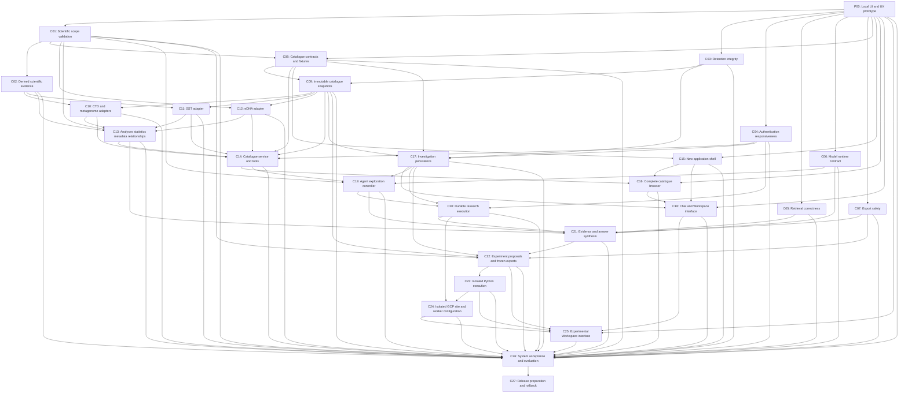

# Component map

P00 and C01–C08 are **Complete locally**; C09–C27 are **Not started**. The sequence is now P00 local UI/UX review,
then the original C01–C27 backend/integration components. IDs C01–C27 are retained.
This map does not authorize implementation. Read [SITE_SEPARATION.md](SITE_SEPARATION.md)
and [UI_UX_BRIEF.md](UI_UX_BRIEF.md), then select one action in [PROMPTS.md](PROMPTS.md).
[STATUS.md](STATUS.md) records progress; [components.json](components.json) is the
exact dependency graph. There are 28 specifications including P00.

| ID | Component | Required predecessors |
|---|---|---|
| P00 | [Local UI and UX prototype](components/P00-local-ui-prototype.md) | None |
| C01 | [Scientific scope validation](components/C01-scientific-scope.md) | P00 |
| C02 | [Derived scientific evidence](components/C02-derived-scientific-evidence.md) | C01 |
| C03 | [Retention integrity](components/C03-retention-integrity.md) | P00 |
| C04 | [Authentication responsiveness](components/C04-authentication-responsiveness.md) | P00 |
| C05 | [Retrieval correctness](components/C05-retrieval-correctness.md) | P00 |
| C06 | [Model runtime contract](components/C06-model-runtime.md) | P00 |
| C07 | [Export safety](components/C07-export-safety.md) | P00 |
| C08 | [Catalogue contracts and fixtures](components/C08-catalogue-contracts.md) | P00, C01 |
| C09 | [Immutable catalogue snapshots](components/C09-catalogue-snapshots.md) | C03, C08 |
| C10 | [CTD and metagenome adapters](components/C10-ctd-metagenome-adapters.md) | C02, C09 |
| C11 | [SST adapter](components/C11-sst-adapter.md) | C02, C09 |
| C12 | [eDNA adapter](components/C12-edna-adapter.md) | C01, C09 |
| C13 | [Analyses statistics metadata relationships](components/C13-scientific-catalogue-sections.md) | C01, C02, C10, C11, C12 |
| C14 | [Catalogue service and tools](components/C14-catalogue-service-tools.md) | C04, C08, C09, C10, C11, C12, C13 |
| C15 | [New application shell](components/C15-application-shell.md) | P00, C08 |
| C16 | [Complete catalogue browser](components/C16-catalogue-browser.md) | P00, C14, C15 |
| C17 | [Investigation persistence](components/C17-investigation-persistence.md) | C03, C04, C08, C09 |
| C18 | [Chat and Workspace interface](components/C18-chat-workspace.md) | P00, C15, C16, C17 |
| C19 | [Agent exploration controller](components/C19-agent-controller.md) | C01, C06, C14, C17 |
| C20 | [Durable research execution](components/C20-durable-execution.md) | C04, C17, C19 |
| C21 | [Evidence and answer synthesis](components/C21-evidence-synthesis.md) | C05, C06, C07, C13, C19, C20 |
| C22 | [Experiment proposals and frozen exports](components/C22-experiment-proposals.md) | C01, C07, C09, C17, C21 |
| C23 | [Isolated Python execution](components/C23-python-sandbox.md) | C22 |
| C24 | [Isolated GCP site and worker configuration](components/C24-gcp-worker-configuration.md) | C20, C23 |
| C25 | [Experimental Workspace interface](components/C25-experimental-workspace.md) | P00, C18, C22, C23, C24 |
| C26 | [System acceptance and evaluation](components/C26-system-acceptance.md) | P00 and all C01–C25 |
| C27 | [Release preparation and rollback](components/C27-release-readiness.md) | C26 |

## Delivery order

P00 is the first implementation and is now accepted and Complete; see STATUS. It uses provisional typed synthetic
fixtures and has no backend prerequisites. Review and refine the local interface
with the user before completing its UX gate. Afterwards, C01 is the recommended
first backend component and is now complete; one C01–C27 component at a time remains the default.
Planning any component can proceed before prerequisite implementation. C01 and
C02 are now Complete locally; C03 retention integrity is also Complete with
disposable PostgreSQL acceptance. C04 authentication responsiveness is Complete locally; C05 is Complete with local and actual disposable PostgreSQL acceptance.
See STATUS and the delivery audit for current verification rather than historical
component receipts alone.

- P00: runnable local UI, human-centered journeys and iterative user review.
- C01–C07: scientific, integrity, runtime and export foundations for v1.
- C08–C14: catalogue contracts, independent snapshots and four-source services.
- C15–C18: integrate and harden the P00 frontend with catalogue/investigation APIs.
- C19–C21: controller, durable execution and retained evidence; connect live UI actions.
- C22–C25: approved experiments, isolation, separate-site configuration and UI integration.
- C26–C27: integrated acceptance, isolation evidence and independent release/rollback preparation.

P00 does not complete C15/C16/C18/C25. Those components reuse its frontend-v1
implementation, reconcile provisional contracts and prove real behavior. C20 owns
live run transport; C21 owns evidence integration. C24 configures the whole isolated
v1 site and worker offline. C27 prepares only that site's release; neither provisions
or deploys. Legacy production remains in place throughout.

## Exact dependency graph

Arrows point from prerequisite to dependent. P00 gates the entry components and
is an explicit design handoff for catalogue contracts and UI integration.

A finished specification or prototype is not a completed integration component.
Required acceptance, compatible behavior and a usable handoff remain necessary.
