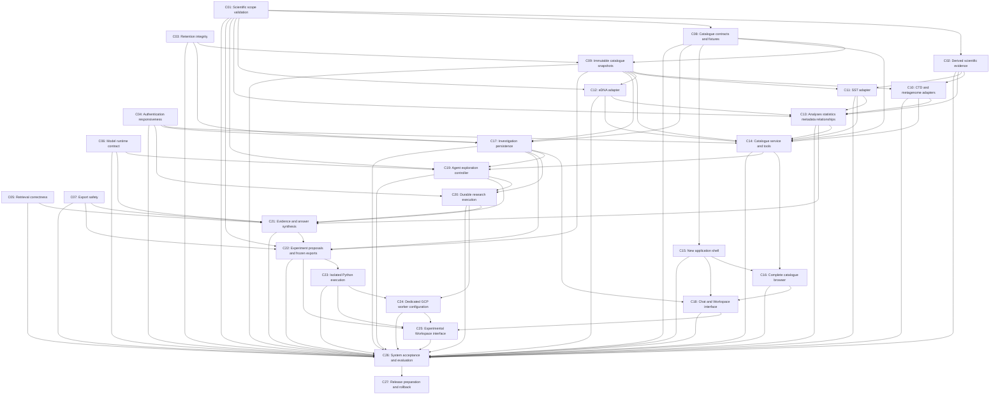

# Component map

All components are **Not started**. This map describes future work; it does not
start that work. Choose one component and one action from [PROMPTS.md](PROMPTS.md).
Each specification contains smaller checkpoints so an interrupted component can
resume without repeating completed work. [STATUS.md](STATUS.md) records actual
progress; [components.json](components.json) contains the exact dependency graph.

| ID | Component | Required predecessors |
|---|---|---|
| C01 | [Scientific scope validation](components/C01-scientific-scope.md) | None |
| C02 | [Derived scientific evidence](components/C02-derived-scientific-evidence.md) | C01 |
| C03 | [Retention integrity](components/C03-retention-integrity.md) | None |
| C04 | [Authentication responsiveness](components/C04-authentication-responsiveness.md) | None |
| C05 | [Retrieval correctness](components/C05-retrieval-correctness.md) | None |
| C06 | [Model runtime contract](components/C06-model-runtime.md) | None |
| C07 | [Export safety](components/C07-export-safety.md) | None |
| C08 | [Catalogue contracts and fixtures](components/C08-catalogue-contracts.md) | C01 |
| C09 | [Immutable catalogue snapshots](components/C09-catalogue-snapshots.md) | C03, C08 |
| C10 | [CTD and metagenome adapters](components/C10-ctd-metagenome-adapters.md) | C02, C09 |
| C11 | [SST adapter](components/C11-sst-adapter.md) | C02, C09 |
| C12 | [eDNA adapter](components/C12-edna-adapter.md) | C01, C09 |
| C13 | [Analyses statistics metadata relationships](components/C13-scientific-catalogue-sections.md) | C01, C02, C10, C11, C12 |
| C14 | [Catalogue service and tools](components/C14-catalogue-service-tools.md) | C04, C08, C09, C10, C11, C12, C13 |
| C15 | [New application shell](components/C15-application-shell.md) | C08 |
| C16 | [Complete catalogue browser](components/C16-catalogue-browser.md) | C14, C15 |
| C17 | [Investigation persistence](components/C17-investigation-persistence.md) | C03, C04, C08, C09 |
| C18 | [Chat and Workspace interface](components/C18-chat-workspace.md) | C15, C16, C17 |
| C19 | [Agent exploration controller](components/C19-agent-controller.md) | C01, C06, C14, C17 |
| C20 | [Durable research execution](components/C20-durable-execution.md) | C04, C17, C19 |
| C21 | [Evidence and answer synthesis](components/C21-evidence-synthesis.md) | C05, C06, C07, C13, C19, C20 |
| C22 | [Experiment proposals and frozen exports](components/C22-experiment-proposals.md) | C01, C07, C09, C17, C21 |
| C23 | [Isolated Python execution](components/C23-python-sandbox.md) | C22 |
| C24 | [Dedicated GCP worker configuration](components/C24-gcp-worker-configuration.md) | C20, C23 |
| C25 | [Experimental Workspace interface](components/C25-experimental-workspace.md) | C18, C22, C23, C24 |
| C26 | [System acceptance and evaluation](components/C26-system-acceptance.md) | All C01–C25 |
| C27 | [Release preparation and rollback](components/C27-release-readiness.md) | C26 |

## How to schedule

C01 is the recommended first implementation when explicitly selected. C03–C07
also have no component prerequisites, but that is eligibility, not permission to
start them. Numerical order is a valid complete sequence; the dependency column
permits other orders. Finish and verify prerequisites before dependent implementation.
Planning a component is allowed before its prerequisites are implemented.

The delivery groups below explain the design; they do not add dependency edges:

- C01–C07: repair existing scientific, integrity, runtime and export risks.
- C08–C14: define and expose the complete four-source catalogue.
- C15–C18: build the application shell, complete browser and investigation UI.
- C19–C21: browse, persist operations and synthesize retained evidence.
- C22–C25: propose and approve experiments, isolate execution and expose results.
- C26–C27: verify the system and prepare release/rollback.

C18 initially uses persisted investigation contracts and fixtures. C20 supplies
live run events, C21 supplies evidence, and C25 integrates experiment interactions.
Their integration must be verified at C26; a shell preview alone is not product
acceptance. C24 prepares infrastructure configuration; cloud application of it
is a later explicit operation. C27 prepares a release, without deploying it.

## Exact dependency graph

An arrow points from a prerequisite to its dependent. All C01–C25 feed C26.

A completed specification is not a completed component. Acceptance evidence,
compatibility checks and a usable handoff are required for implementation completion.
