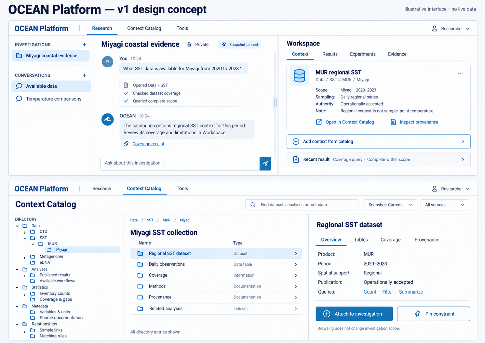

# Research and Context Catalog UI concept

This static image was generated during planning on 2026-10-12. It is a visual
reference, not a browser screenshot, functioning prototype, scientific result
or acceptance evidence. No live counts or measurement charts are depicted.

The upper screen illustrates a private named investigation, separate
conversations, Chat and Workspace. Workspace tabs are Context, Results,
Experiments and Evidence. The lower screen illustrates a standalone Context
Catalog with the five-root tree, directory listing and dataset inspector.

Implementation behavior is governed by MASTER_PLAN and component specifications:
resizable panes; accessible mobile alternatives; complete permitted pagination;
snapshot-aware navigation; explicit Attach versus Pin constraint; published
authority retained without upgrading it; experimental status always visible.

The image's text and small control details are illustrative. Do not use the
image as a source of actual dataset inventory, permissions, publication status,
counts, scientific approval or a hidden requirement to replicate every pixel.

Original preview:
/Users/jaronchai/.codex/generated_images/01a12f41-f8d4-7e71-8ebf-5d57fc12348b/exec-a25a4d74-7e19-457f-8496-b169ccc9fa56.png

A byte-identical copy is retained here so fresh chats and other checkouts need
not access the original local preview path.
